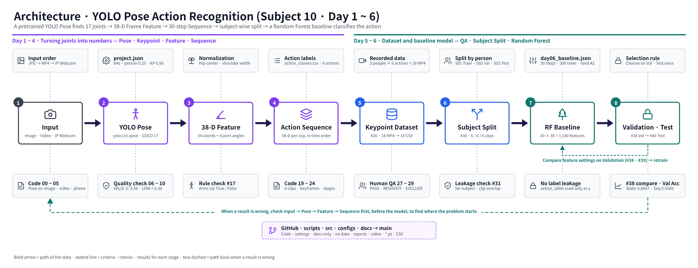
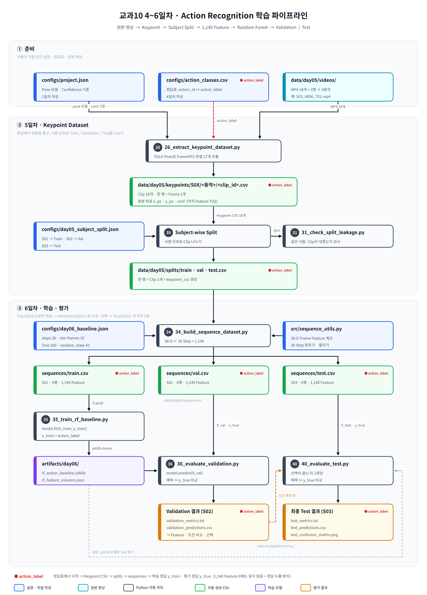

# yolo-pose-action-recognition-project — YOLO Pose Action Recognition

<p align="right"><a href="README.md">한국어</a> | <b>English</b></p>

<p align="center">
  
  
  
  
  
  
  <br>
  
  
  
  
</p>

## Project Overview

### Architecture

A pretrained **YOLO Pose (`yolo11n-pose.pt`)** finds 17 body joints. Those coordinates become a **38-D Frame Feature → 30-step Sequence**, and a **Random Forest baseline** classifies the action. The data is split **by person (S01 Train · S02 Validation · S03 Test)**; settings are compared on Validation only, and Test is checked **once**.



<br>

### Summary

A hands-on project from Subject 10 · Pose Estimation. Instead of training a new Pose model, it builds, day by day, **the process of turning joints found by a pretrained model into data for action recognition**.

```text
Pose → Keypoint → Feature → Sequence → Dataset → Action Model → (Realtime → Tracking → Augmentation → Failure Analysis)
```

The goal is not a high score but **a pipeline where, when a result is wrong, you can trace the first stage that went wrong**. Quality is checked at every stage, data from the same person never mixes across Train and Test, and criteria were not changed after looking at Test.

> **Day 1 ~ 6** are included so far. Day 7 ~ 10 (realtime · tracking · augmentation · failure analysis) will be added as the course goes on.

<br>

### Results

| Stage | Method | Key result |
|---|---|---|
| Day 1 · Pose input | Same Pose code checked in order: image → MP4 → IP Webcam | Input pipeline `00` ~ `05` · phone camera frame capture |
| Day 2 · Keypoint quality | Per-joint confidence → VALID ≥ 0.50 · WARNING · LOW < 0.30 | Quality comparison CSV · skeleton quality images · **Person BBox confidence ≠ Keypoint confidence** |
| Day 3 · Frame Feature | Normalize by hip center (position) + shoulder width (scale) · elbow · knee angles | **38-D = 34 coords + 4 angles** · rule check (#17) arms up **True** (min confidence 0.971) · sitting pose also **True** → one rule cannot tell them apart |
| Day 4 · Action Sequence | Join the 38-D of 6 action clips in time order | Sequence CSV per clip · keyframes · stage checks `19` ~ `24` |
| Day 5 · Dataset · Split | 3 people × 6 actions = **18 MP4** → keypoint CSV · auto QA + human QA · split by person | AUTO_PASS **13** · CHECK **5** → human-checked PASS · approved clips **18** · Train / Val / Test **6 / 6 / 6** · leakage check OK |
| Day 6 · RF baseline | 30 steps × 38-D = **1,140 features** · Random Forest (300 trees · seed 42) | Validation (S02): single frame 38 features **0.6667 (4/6)** vs 30-step **0.5000 (3/6)** · Macro F1 0.5556 vs 0.4444 |

Day 6 numbers come from **6 Validation clips**. On this data the 30-step sequence missed one more clip than the single frame, but with so few clips this is not generalized (the instructor's material shows 0.6667 / 0.5556 for both).

**Why AI output was not taken at face value**

- **A CSV is a prediction, not ground truth** — coordinates and confidence from YOLO Pose are predictions. Confidence 0.99 was never read as "99% accuracy"; results were drawn back on the original image or video to check.
- **Rules break easily** — the Day 3 rule "wrist above shoulder" caught arms up, but also judged a sitting pose as True. That is why the project moved from a single-frame rule to **a sequence of frames** and a trained model.
- **Labels come only from the label table** — the action name (`action_label`) is not predicted by YOLO; it is attached from the `action_classes.csv` table. In training it is used **only as y**, never as input (X).

<br>

### Principles

| Principle | Detail |
|---|---|
| Same processing rules | Training and inference use the same normalization · feature · sequence length (`src/feature_utils.py` · `src/sequence_utils.py`) |
| Quality check at each stage | Input → keypoint confidence → auto QA → human QA (PASS · RESHOOT · EXCLUDE) |
| Split by person | S01 Train · S02 Validation · S03 Test · assigned before building sequences (`configs/day05_subject_split.json`) |
| Choose on Validation only | Comparisons #38 · #39 use Validation · Test (#40) runs once after choosing |
| Raw data apart from features | Raw keypoints saved on Day 5 → features rebuilt on Day 6 · changing features does not require running Pose again |
| Settings in files | Model · confidence · sequence length · RF settings are read from `configs/*.json`, not hard-coded |

<br>

### Training Pipeline

A flow chart **drawn by hand while tracing** how Day 4 ~ 6 data passes through files and code to the model and evaluation. It also shows how the label (`action_label`) travels from the label table to evaluation.

<p align="center"></p>

*Colors separate setting files · raw video · Python steps · generated CSV · model · evaluation (labels in Korean).* Details → [file trace table · explanation (Korean)](docs/shl_pose_action_pipeline_and_explanation.md)

<br>

### Quick Links

| Folder | What it is | Key |
|---|---|---|
| [**scripts**](scripts) | Practice code by day (`00` ~ `40`) | Run in number order from the project root |
| [**src**](src) | Shared functions | `common.py` settings · paths · `pose_utils.py` COCO 17 · `feature_utils.py` 38-D · `sequence_utils.py` sequences |
| [**configs**](configs) | Setting files | `project.json` Pose criteria · `day05_subject_split.json` person split · `day06_baseline.json` RF settings |
| [**docs**](docs) | Docs · images | Architecture · Day 4 ~ 6 pipeline chart · file trace table |

| Day | 1 | 2 | 3 | 4 | 5 | 6 |
|---|---|---|---|---|---|---|
| Topic | Pose input | Keypoint quality | 38-D Feature | Action Sequence | QA · Split | RF baseline |
| Code | `00~05` | `06~10` | `11~17` | `19~24` | `25~32` | `33~40` |

<br><br>

## Quick Start

You need: Windows 11 PC · WSL2 Ubuntu · [uv](https://docs.astral.sh/uv/) · without a GPU, `device: "auto"` uses the CPU

**Step 1 · Get the code** — keep the project inside WSL (`~/ai_vision/`)

```bash
mkdir -p ~/ai_vision && cd ~/ai_vision
git clone https://github.com/sunghyunglee/yolo-pose-action-recognition-project.git subject10_pose_action
cd subject10_pose_action
```

**Step 2 · Install**

```bash
uv sync
source .venv/bin/activate
python scripts/00_check_environment.py
```

**Step 3 · Add data** — videos and images are not in Git. Put the course data into the folder for each day

```text
data/day01/  data/day02/  data/day03/  data/day04/  data/day05/videos/  (S01_A001_T01.mp4 ~ S03_A006_T01.mp4)
```

**Step 4 · Run** — terminal at the project root, code in number order

```bash
python scripts/26_extract_keypoint_dataset.py
python scripts/30_build_subject_split.py
python scripts/31_check_split_leakage.py
python scripts/34_build_sequence_dataset.py
python scripts/35_train_rf_baseline.py
python scripts/36_evaluate_validation.py
python scripts/38_compare_static_vs_sequence.py
python scripts/40_evaluate_test.py
```

Before Day 5 human QA (#28), write PASS · RESHOOT · EXCLUDE by hand in the `human_decision` column of `keypoint_clip_review.csv`. Results are saved in `reports/dayXX/` and the model in `artifacts/day06/rf_action_baseline.joblib`.

<br><br>

## Notes

- **Raw video · images · `data/` · `reports/` · `artifacts/` · `*.pt` · generated CSV are not pushed to Git** — only code · settings · docs.
- Images or videos that show the faces of recorded people are not published.
- The confidence thresholds (0.50 / 0.30) are for teaching, not official YOLO values. A real project sets them again with validation data.
- `scripts/18_video_frame_features.py` will be added after a code error in the course material is checked.
