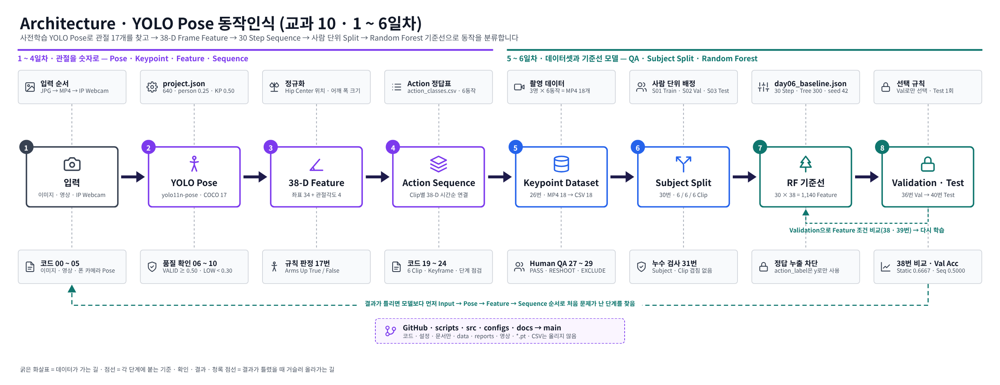
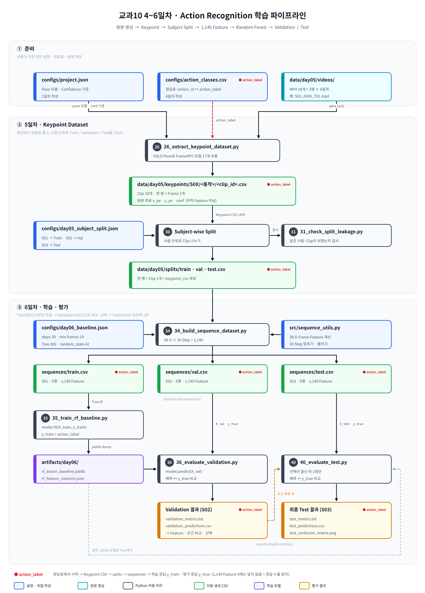

# yolo-pose-action-recognition-project — YOLO Pose 기반 동작인식

<p align="right"><b>한국어</b> | <a href="README.en.md">English</a></p>

<p align="center">
  
  
  
  
  
  
  <br>
  
  
  
  
</p>

## 프로젝트 소개

### Architecture

사전학습 **YOLO Pose(`yolo11n-pose.pt`)** 로 사람 관절 17개를 찾고, 그 좌표를 **38-D Frame Feature → 30 Step Sequence** 로 바꿔 **Random Forest 기준선**으로 동작을 분류합니다. 데이터는 **사람 단위(S01 Train · S02 Validation · S03 Test)** 로 나누고, 조건 비교는 Validation 으로만 한 뒤 Test 는 **한 번만** 확인합니다.



<br>

### 개요

교과 10 · 자세추정(Pose Estimation) 실습 프로젝트입니다. Pose 모델을 새로 학습하지 않고, **사전학습 모델이 찾은 관절을 동작인식용 데이터로 바꾸는 과정**을 1일차부터 단계별로 구현했습니다.

```text
Pose → Keypoint → Feature → Sequence → Dataset → Action Model → (Realtime → Tracking → Augmentation → Failure Analysis)
```

목표는 높은 점수가 아니라 **결과가 틀렸을 때 어느 단계에서 처음 틀렸는지 따라갈 수 있는 Pipeline** 입니다. 단계마다 품질을 확인하고, 같은 사람의 데이터가 Train · Test 에 섞이지 않게 나누고, Test 를 본 뒤에는 기준을 고치지 않았습니다.

> 현재 **1 ~ 6일차**까지 반영했습니다. 7 ~ 10일차(실시간 · Tracking · 보강 · 실패분석)는 진행하면서 추가합니다.

<br>

### 작업 결과

| 단계 | 방법 | 핵심 결과 |
|---|---|---|
| 1일차 · Pose 입력 | 이미지 → MP4 → IP Webcam 순서로 같은 Pose 코드 검증 | 입력 Pipeline `00` ~ `05` · 폰 카메라 Frame 캡처 |
| 2일차 · Keypoint 품질 | 관절별 Confidence → VALID ≥ 0.50 · WARNING · LOW < 0.30 | 품질 비교 CSV · Skeleton 품질 그림 · **Person BBox Confidence ≠ Keypoint Confidence** |
| 3일차 · Frame Feature | Hip Center 위치 + Shoulder Width 크기 정규화 · 팔꿈치 · 무릎 각도 | **38-D = 좌표 34 + 각도 4** · 규칙 판정(17번) 팔 들기 **True** (최소 Confidence 0.971) · 앉은 자세도 **True** → 규칙 하나로는 구분 못 함 |
| 4일차 · Action Sequence | 6개 Action Clip 의 38-D 를 시간순 연결 | Clip 별 Sequence CSV · Keyframe · 단계별 점검 `19` ~ `24` |
| 5일차 · Dataset · Split | 3명 × 6동작 = **MP4 18개** → Keypoint CSV · 자동 QA + Human QA · 사람 단위 Split | AUTO_PASS **13** · CHECK **5** → 사람 확인 PASS · 승인 Clip **18** · Train / Val / Test **6 / 6 / 6** · 누수 검사 OK |
| 6일차 · RF 기준선 | 30 Step × 38-D = **1,140 Feature** · Random Forest (Tree 300 · seed 42) | Validation(S02) 한 장면 38 Feature **0.6667 (4/6)** vs 30 Step **0.5000 (3/6)** · Macro F1 0.5556 vs 0.4444 |

6일차 숫자는 Validation **6 Clip** 결과입니다. 이번 데이터에서는 30 Step Sequence 가 한 장면보다 1개 더 틀렸지만, Clip 수가 적어 일반화하지 않습니다(강사님 자료는 둘 다 0.6667 / 0.5556).

**AI 결과를 그대로 믿지 않은 이유**

- **CSV 는 예측이지 정답이 아님** — YOLO Pose 가 만든 좌표 · Confidence 는 예측 결과입니다. Confidence 0.99 를 "정확도 99%" 로 읽지 않고, 원본 이미지 · 영상에 다시 그려서 확인했습니다.
- **규칙은 쉽게 무너짐** — 3일차 "손목이 어깨보다 위" 규칙은 팔 들기를 맞혔지만 앉은 자세도 True 로 판정했습니다. 그래서 한 장면 규칙이 아니라 **여러 Frame 을 이은 Sequence** 와 학습 모델로 넘어갔습니다.
- **정답은 기준표에서만** — 동작 이름(`action_label`)은 YOLO 가 예측하지 않고 `action_classes.csv` 정답표에서 붙입니다. 학습 때는 **y 로만** 쓰고 입력(X)에는 넣지 않았습니다.

<br>

### 지킨 원칙

| 원칙 | 내용 |
|---|---|
| 같은 처리 기준 | 학습과 추론에 같은 정규화 · Feature · Sequence 길이 사용 (`src/feature_utils.py` · `src/sequence_utils.py`) |
| 단계마다 품질 검사 | 입력 → Keypoint Confidence → 자동 QA → Human QA(PASS · RESHOOT · EXCLUDE) |
| 사람 단위 Split | S01 Train · S02 Validation · S03 Test · Sequence 만들기 전에 배정(`configs/day05_subject_split.json`) |
| Validation 으로만 선택 | 38 · 39번 비교는 Validation 으로 · Test(40번)는 고른 뒤 1회 |
| 원본과 Feature 분리 | 5일차에 원본 Keypoint 저장 → 6일차에 Feature 다시 계산 · Feature 를 바꿔도 Pose 를 다시 돌리지 않음 |
| 설정은 파일로 | 모델 · Confidence · Sequence 길이 · RF 설정은 `configs/*.json` 에서 읽고 코드에 하드코딩하지 않음 |

<br>

### 학습 파이프라인

4 ~ 6일차 데이터가 어떤 파일 · 코드를 거쳐 모델과 평가까지 가는지 **직접 따라가며 그린 흐름도** 입니다. 정답(`action_label`)이 정답표에서 평가까지 어떻게 이어지는지 함께 표시했습니다.

<p align="center"></p>

*설정 파일 · 원본 영상 · Python 처리 · 자동 생성 CSV · 모델 · 평가를 색으로 구분했습니다.* 자세한 설명 → [파일 추적표 · 설명](docs/shl_pose_action_pipeline_and_explanation.md)

<br>

### 바로가기

| 폴더 | 무엇인가 | 핵심 |
|---|---|---|
| [**scripts**](scripts) | 일차별 실습 코드 (`00` ~ `40`) | 번호 순서대로 프로젝트 루트에서 실행 |
| [**src**](src) | 공통 함수 | `common.py` 설정 · 경로 · `pose_utils.py` COCO 17 · `feature_utils.py` 38-D · `sequence_utils.py` Sequence |
| [**configs**](configs) | 설정 파일 | `project.json` Pose 기준 · `day05_subject_split.json` 사람 배정 · `day06_baseline.json` RF 설정 |
| [**docs**](docs) | 문서 · 그림 | Architecture · 4 ~ 6일차 파이프라인 흐름도 · 파일 추적표 |

| 일⁠차 | 1 | 2 | 3 | 4 | 5 | 6 |
|---|---|---|---|---|---|---|
| 주제 | Pose 입력 | Keypoint 품질 | 38-D Feature | Action Sequence | QA · Split | RF 기준선 |
| 코드 | `00~05` | `06~10` | `11~17` | `19~24` | `25~32` | `33~40` |

<br><br>

## 빠른 시작

준비물: Windows 11 PC · WSL2 Ubuntu · [uv](https://docs.astral.sh/uv/) · GPU 가 없으면 `device: "auto"` 로 CPU 사용

**1단계 · 받기** — 프로젝트는 WSL 안(`~/ai_vision/`)에 둡니다

```bash
mkdir -p ~/ai_vision && cd ~/ai_vision
git clone https://github.com/sunghyunglee/yolo-pose-action-recognition-project.git subject10_pose_action
cd subject10_pose_action
```

**2단계 · 설치**

```bash
uv sync
source .venv/bin/activate
python scripts/00_check_environment.py
```

**3단계 · 데이터 넣기** — 영상 · 이미지는 Git 에 없습니다. 수업 데이터를 일차별 폴더에 넣습니다

```text
data/day01/  data/day02/  data/day03/  data/day04/  data/day05/videos/  (S01_A001_T01.mp4 ~ S03_A006_T01.mp4)
```

**4단계 · 실행** — 터미널 위치는 프로젝트 루트, 코드는 번호 순서대로

```bash
python scripts/26_extract_keypoint_dataset.py
python scripts/30_build_subject_split.py
python scripts/31_check_split_leakage.py
python scripts/34_build_sequence_dataset.py
python scripts/35_train_rf_baseline.py
python scripts/36_evaluate_validation.py
python scripts/38_compare_static_vs_sequence.py
python scripts/40_evaluate_test.py
```

5일차 Human QA(28번)는 실행 전에 `keypoint_clip_review.csv` 의 `human_decision` 칸에 PASS · RESHOOT · EXCLUDE 를 직접 적습니다. 결과는 `reports/dayXX/`, 모델은 `artifacts/day06/rf_action_baseline.joblib` 에 저장됩니다.

<br><br>

## 주의사항

- **원본 영상 · 이미지 · `data/` · `reports/` · `artifacts/` · `*.pt` · 생성 CSV 는 Git 에 올리지 않습니다** — 코드 · 설정 · 문서만 올립니다.
- 촬영한 사람의 얼굴이 보이는 이미지 · 영상은 공개하지 않습니다.
- Confidence 기준(0.50 / 0.30)은 교육용 기준이며 YOLO 공식 기준이 아닙니다. 실제 프로젝트에서는 검증 데이터로 다시 정합니다.
- `scripts/18_video_frame_features.py` 는 수업자료 코드에 오류가 있어 확인 후 추가할 예정입니다.
