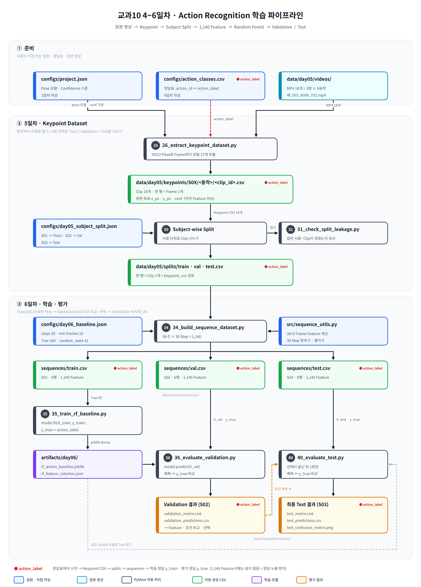

# 교과10 4~6일차 데이터 파이프라인 스스로 그리기 — 제출

| 항목 | 내용 |
|---|---|
| 구분 | 개인 실습 |
| 작성자 | Sung Hyung Lee |
| 제출일 | 2026-11-19 |
| 흐름도 | 문서 맨 아래 부록 |

> 표시 규칙: **⚠ 확인** = 5일차 코드(26~30번) 원본을 아직 직접 열어 보지 못해서, 제출 전에 내 `scripts/` 파일과 대조해야 하는 칸.
> 강사님 안내에 따라 흐름도에서는 QA 단계(27~29번)를 뺐다.

---

## Ⅰ. 파일 추적표 (미션 1~4)

### 미션 1. 설정 파일과 원본 영상

#### 문제 1-1. 파일의 역할

| 찾아볼 파일 | 언제·누가 작성했나요? | 어떤 정보를 담고 있나요? | 다음에 어떤 Python 코드가 사용하나요? |
|---|---|---|---|
| `configs/project.json` | 1일차 · 개발자가 직접 작성 | Pose 모델(`yolo11n-pose.pt`), image_size 640, person·keypoint Confidence 기준(0.25 / 0.50), device | `src/common.py`의 `load_config()`를 통해 Pose를 돌리는 코드 → 5일차 **26번** |
| `configs/action_classes.csv` | 4일차 · 개발자가 직접 작성 | 동작 정답표: `action_id`(A001~A006) ↔ `action_label`(bend_return 등), 동작 설명 | 4일차 20번(검사)·22번 → 5일차 **26번**에서 `action_label`을 붙일 때 |
| `data/day05/videos/` 안의 MP4 18개 | 5일차 · 사람이 직접 촬영·배치 (3명 × 6동작 × 1 Take) | 원본 영상. 파일 이름에 사람·동작·Take 정보 (`S03_A006_T01.mp4`) | 5일차 **26번** (YOLO Pose로 Keypoint 추출) |
| `configs/day05_subject_split.json` | 5일차 · 개발자가 직접 작성 | 사람 단위 배정: S01 → Train, S02 → Validation, S03 → Test | 5일차 **30번** (Subject-wise Split) ⚠ 확인 |
| `configs/day06_baseline.json` | 6일차 · 개발자가 직접 작성 | `sequence_steps` 30, `min_valid_frames` 10, `random_state` 42, `n_estimators` 300, `max_depth` null | 6일차 **34번**(Sequence 생성), **35번**(학습), 38·39번(비교 실험) |

#### 문제 1-2. 한 영상의 정답 추적 — `S03_A006_T01.mp4`

| 질문 | 답 |
|---|---|
| 1. `S03`이 뜻하는 것 | Subject 03 = 세 번째 촬영자(사람). Split에서 **Test**에 배정된 사람 |
| 2. `A006`이 뜻하는 것 | Action ID 006 = 여섯 번째 동작 |
| 3. 정답 동작 이름 + 확인한 파일·컬럼 | **`wave`** (한 손을 들어 흔든다) · `configs/action_classes.csv`에서 `action_id` = A006 행의 `action_label` 컬럼 |
| 4. YOLO Pose 예측인가, 기준표를 읽어 붙이나? | **미리 작성된 기준표를 읽어 붙인다.** YOLO Pose는 관절 좌표만 만들고 동작 이름은 모른다. 파일 이름의 `A006`을 `action_classes.csv`에서 찾아 `action_label`을 붙인다. 근거: Keypoint CSV가 `keypoints/S03/wave/` 폴더에 저장되고, 6일차 34번은 split CSV의 `action_label` 값을 그대로 복사한다(예측하지 않음). |

**생각해 볼 문제** — `project.json → action_classes.csv → MP4`를 순서대로 변환하는 구조인가?
답: **아니다.** 세 파일은 서로를 변환하지 않는다. **26번 프로그램 하나가 세 입력을 동시에 읽는 구조**다. `project.json`은 "어떤 모델로 어떤 기준으로", MP4는 "무엇을", `action_classes.csv`는 "정답이 무엇인지"를 각각 26번에 넘겨 준다. 그래서 그림에서도 세 화살표가 26번 하나로 모인다.

---

### 미션 2. Keypoint CSV가 만들어지는 코드

#### 문제 2-1. 4일차 22번 vs 5일차 26번

| 확인 항목 | 4일차 22번 `22_build_action_sequences.py` | 5일차 26번 `26_extract_keypoint_dataset.py` |
|---|---|---|
| 입력 영상의 수 | **6개** (한 사람 · 6동작) | **18개** (3명 × 6동작) |
| 산출물의 저장 위치 | `<action_label>_sequence.csv` (동작 이름으로 저장 → 같은 동작 Take가 여러 개면 덮어씀) · 폴더 `data/day04/...` ⚠ 확인 | `data/day05/keypoints/<subject>/<action_label>/<clip_id>.csv` (Clip마다 1개) |
| CSV 한 행은 무엇을 나타내나요? | Frame 1개의 **38-D Feature** | Frame 1개의 **원본 Keypoint** (관절 17개 좌표·Confidence) |
| 원본 Keypoint인가, 가공한 Feature인가? | **가공한 Feature** (정규화 34 + 각도 4 = 38-D) | **원본 Keypoint** (픽셀 좌표 x_px · y_px · conf 등) |
| `action_label`은 어떻게 연결되나요? | `action_classes.csv`의 동작 이름이 출력 파일 이름이 됨 | 파일 이름의 `action_id` → `action_classes.csv`에서 찾아 저장 폴더 이름과 CSV 정보로 연결 |
| 이후 6일차 학습에 직접 사용하는 데이터 | 사용하지 않음 (4일차 연습용) | **사용함** — 34번이 이 Keypoint CSV를 읽어 38-D → 30 Step → 1,140 Feature로 다시 만든다 |

#### 문제 2-2. 5일차 Keypoint CSV 컬럼

| 항목 | 답 |
|---|---|
| 관절 개수 | **17개** (COCO 17 Keypoint) |
| 관절 하나에 저장하는 값의 종류 (5가지) | `x_px`, `y_px`, `conf` + 나머지 2개 ⚠ 확인 (26번에서 `for name in COCO_KEYPOINT_NAMES` 아래 컬럼 이름을 만드는 줄을 보고 채우기) |
| 관절 데이터 컬럼 개수 | **17 × 5 = 85개** |
| 메타데이터 컬럼 개수 | ⚠ 확인 (`frame_id` 등 관절이 아닌 컬럼 수를 셈) |
| 전체 CSV 컬럼 개수 | 85 + 메타데이터 수 ⚠ 확인 |
| 정답을 저장하는 컬럼 이름 | **`action_label`** |

> 확인 방법 (프로젝트 루트에서):
> ```bash
> head -1 data/day05/keypoints/S03/wave/S03_A006_T01.csv | tr ',' '\n' | nl
> ```
> 마지막 번호 = 전체 컬럼 수. `nose_`로 시작하는 줄 5개가 "값의 종류 5가지".

**탐구 질문** — 26번 CSV를 곧바로 `38-D Feature CSV`라고 불러도 될까?
답: **안 된다.** 26번 CSV에는 YOLO Pose가 찾은 **원본 픽셀 좌표와 Confidence**만 있다. 38-D는 Hip Center 기준으로 위치를 맞추고 Shoulder Width로 크기를 맞춘 **정규화 좌표 34개 + 관절각도 4개**다. 이 계산은 6일차 `src/sequence_utils.py`의 `build_frame_feature_matrix()`가 Keypoint CSV의 `{관절}_x_px`, `{관절}_y_px`를 읽어서 한다. 그래서 34번 코드에 "Keypoint CSV를 38-D Frame Feature로 변환한다"는 단계가 따로 있다.

#### 문제 2-3. 결과 파일 1개

| 질문 | 답 |
|---|---|
| `S03_A006_T01.mp4`의 Keypoint CSV 정확한 상대 경로 | **`data/day05/keypoints/S03/wave/S03_A006_T01.csv`** |
| 한 파일에 여러 Frame 행이 저장되는 이유 | 동작은 한 장면이 아니라 시간에 따른 변화이므로, 영상의 Frame마다 관절 위치를 한 행씩 시간 순서대로 저장해야 나중에 Sequence(움직임)를 만들 수 있기 때문이다. |

---

### 미션 3. Split 파일 추적

> 강사님 안내로 QA(27~29번)는 흐름도에서 제외했다. 표는 참고용으로 채운다.

| Python 번호 | 발견한 정확한 파일명 | 주로 읽는 입력 파일 | 자동 생성·검사하는 결과 파일 | 사람의 수동 작업이 필요한가요? |
|---|---|---|---|---|
| 27번 | ⚠ 확인 | Keypoint CSV 18개 | `keypoint_clip_review.csv` (AUTO_PASS / CHECK) | 없음 (자동) |
| 28번 | `28_validate_human_review.py` | `keypoint_clip_review.csv` (`human_decision` 칸) | 검사만 (`Required human review: OK`) | **필요** — 실행 전에 사람이 `human_decision`에 PASS / RESHOOT / EXCLUDE 입력 |
| 29번 | ⚠ 확인 | 검토가 끝난 review CSV | `data/day05/manifests/approved_clip_manifest.csv` (18행) | 없음 (자동) |
| 30번 | ⚠ 확인 | `approved_clip_manifest.csv` + `configs/day05_subject_split.json` | `data/day05/splits/train.csv · val.csv · test.csv` | 없음 (자동, 배정 기준 json만 사람이 작성) |
| 31번 | `31_check_split_leakage.py` | `data/day05/splits/*.csv` | 검사만 (Subject·Clip 겹침 없음, `Leakage check: OK`) | 없음 (자동) |

#### 문제 3-1. Human QA의 위치

| 질문 | 답 |
|---|---|
| 1. AUTO_PASS면 사람은 전혀 확인하지 않아도 되나요? | 수정된 28번 기준으로 AUTO_PASS는 Human QA를 생략할 수 있다(`UNREVIEWED` 유지). 필수 검토는 CHECK Clip만. 다만 자동 기준을 통과했다고 동작 정답까지 맞다는 보장은 아니다. |
| 2. PASS / RESHOOT / EXCLUDE를 입력하는 파일 | `keypoint_clip_review.csv`의 `human_decision` 컬럼 |
| 3. 최종 승인 목록 CSV를 생성하는 Python 번호 | **29번** → `approved_clip_manifest.csv` |

#### 문제 3-2. 두 종류의 `test.csv`

| 비교 항목 | 5일차 `splits/test.csv` | 6일차 `sequences/test.csv` |
|---|---|---|
| 생성 Python 코드 번호 | **30번** | **34번** |
| 전체 상대 경로 | `data/day05/splits/test.csv` | `data/day06/sequences/test.csv` |
| CSV 한 행이 나타내는 것 | Clip 1개의 **목록 정보** (clip_id, subject, action_id, action_label, 파일 경로) | Clip 1개의 **모델 입력** (Clip 정보 8개 + 1,140 Feature) |
| 원본 Keypoint CSV 경로가 들어 있나요? | **있음** (`keypoint_csv` 컬럼) | **없음** (경로 대신 계산된 숫자) |
| 1,140개 모델 입력 Feature가 들어 있나요? | **없음** | **있음** (`t00_nose_x` … `t29_right_knee_angle`) |
| 실제 동작 정답(`action_label`)이 들어 있나요? | **있음** | **있음** (Feature가 아니라 정답 y로 사용) |

**설명 문제** — 같은 이름인데 왜 두 파일이 필요한가?
답: 5일차 `splits/test.csv`는 "어떤 Clip이 Test인지"를 정한 **목록(주소록)**이고, 6일차 `sequences/test.csv`는 그 목록을 따라 Keypoint를 읽어 계산한 **모델이 바로 먹는 숫자 표**다. 목록과 계산 결과를 나눠 두면, Sequence 길이(30 Step)나 Feature를 바꿔도 사람 단위 Split은 그대로 둔 채 34번만 다시 실행하면 된다.

---

### 미션 4. 1,140개 Feature와 모델 파일

| 번호 | 정확한 파일명 |
|---|---|
| 34번 (Feature 생성) | `scripts/34_build_sequence_dataset.py` |
| 35번 (모델 학습) | `scripts/35_train_rf_baseline.py` |
| 36번 (Validation) | `scripts/36_evaluate_validation.py` |
| 40번 (Test) | `scripts/40_evaluate_test.py` |

#### 문제 4-1. 숫자 Feature 계산식

```text
Frame 하나 = (관절좌표 34개) + (관절각도 4개)
           = 38-D Feature

Clip 하나  = 30 Step × 38-D Feature
           = 1,140개 숫자
```

| 항목 | 답 |
|---|---|
| 공통 함수 파일 | `src/sequence_utils.py` (`build_frame_feature_matrix`, `resample_sequence`, `flatten_sequence`, `sequence_feature_names`) |
| 실행 Python 파일 | `scripts/34_build_sequence_dataset.py` |

#### 문제 4-2. 학습 파일과 평가 파일

| 질문 | 찾아서 기록 |
|---|---|
| Random Forest를 학습시키는 Python 파일명 | `scripts/35_train_rf_baseline.py` |
| 실제 학습을 시작하는 함수 호출 | `model.fit(X_train, y_train)` |
| 학습된 모델을 저장하는 함수 호출 | `joblib.dump(model, MODEL_PATH)` |
| 최종 모델의 파일명과 확장자 | `artifacts/day06/rf_action_baseline.joblib` (`.joblib`) |
| Feature 이름·순서를 별도로 저장한 파일 | `artifacts/day06/rf_feature_columns.json` |
| Validation 평가를 수행하는 Python 파일 | `scripts/36_evaluate_validation.py` |
| Test 평가를 수행하는 Python 파일 | `scripts/40_evaluate_test.py` |

#### 문제 4-3. 정답 누출 여부

| 질문 | 답 |
|---|---|
| 1. `X_train`에 `action_label`을 넣어도 될까요? | **안 된다.** 정답을 입력에 넣으면 모델이 동작을 배우지 않고 정답을 베낀다(정답 누출). 35번은 `META_COLUMNS`(clip_id, subject, action_id, action_label, take, valid_frames, first/last_valid_frame 8개)를 빼고 나머지 1,140개만 X로 쓴다. |
| 2. `y_train`에는 어떤 값이 들어가야 하나요? | `sequences/train.csv`의 **`action_label`** (S01 6개 Clip의 실제 동작 이름) |
| 3. `X_test`와 `y_true`는 어떤 점이 다른가요? | `X_test` = S03의 1,140 Feature(모델에 넣는 입력). `y_true` = S03의 실제 `action_label`(모델에 주지 않고 예측과 **비교만** 하는 정답). |
| 4. Test 정답·예측·정오답 비교 CSV 경로 | `reports/day06/metrics/test_predictions.csv` |

---

## Ⅱ. 학습 파이프라인 흐름도 (미션 5)

> 흐름도 그림은 이 문서 **맨 아래 「부록. 학습 파이프라인 흐름도」**에 있다.

**범례** — 설정 파일(직접 작성): 파랑 / 원본 영상: 하늘 / Python 자동 처리: 회색 + 번호 / 자동 생성 CSV: 초록 / 학습 모델: 보라 / 평가 결과: 주황 / `● action_label` 표시 = 정답이 들어 있는 파일

**입력 데이터 흐름**
`MP4 18개` → 26번 → `keypoints/*.csv` → 30번 → `splits/*.csv` → 34번 → `sequences/train·val·test.csv`(1,140 Feature) → 35번 → `.joblib` → 36번 / 40번 → 예측 결과

**정답 라벨 흐름**
`action_classes.csv` → 26번(파일 이름의 A00X로 찾아 붙임) → Keypoint CSV → `splits/*.csv` → `sequences/*.csv` → `y_train`(35번 학습 정답) · `y_true`(36·40번 평가 정답) → `validation_predictions.csv` · `test_predictions.csv`에서 예측과 비교

| 반드시 들어갈 요소 | 확인 |
|---|---|
| 4일차 프로젝트 설정과 Action 정답표 | ✅ |
| 5일차 MP4 영상 18개 | ✅ |
| 5일차 26번의 입력과 자동 생성 결과 | ✅ |
| 27~29번 QA·Human Review·승인 과정 | 강사님 안내로 제외 |
| 30번 Train / Validation / Test 목록 | ✅ |
| 6일차 34번의 세 종류 Sequence CSV | ✅ |
| S01 Train · S02 Validation · S03 Test 구분 | ✅ |
| 35번 Random Forest 모델 파일(.joblib) | ✅ |
| 36번 Validation 평가와 40번 최종 Test 평가 | ✅ |
| 각 박스에 실제 파일명·경로, 필요한 곳에 코드 번호 | ✅ |
| 설정 파일·자동 생성 CSV·학습 모델을 다른 색·도형으로 구분 | ✅ |
| `action_label` 시작점 → 성능평가 정답까지 표시 | ✅ |

---

## Ⅲ. 설명 (미션 6)

**1. 5일차에 Keypoint 원본을 저장하고 6일차에 다시 Feature를 만드는 이유는 무엇인가요?**
원본을 남겨 두면 Feature 만드는 방법을 바꿀 때 영상에서 YOLO Pose를 다시 돌리지 않아도 된다. 6일차에도 38번(한 장면 vs 30 Step), 39번(좌표만 vs 좌표+각도)처럼 Feature 조건을 바꿔 비교했는데, 그때마다 같은 Keypoint CSV에서 다시 계산만 하면 됐다. 무거운 단계(Pose 추출)와 자주 바뀌는 단계(Feature 설계)를 나눈 것이다.

**2. 4일차 22번에서 이미 만든 38-D Sequence와 5·6일차 데이터셋은 어떤 관계인가요?**
같은 38-D 계산 방법(정규화 34 + 각도 4)을 쓰지만 데이터는 이어지지 않는다. 22번은 한 사람·6개 영상으로 "영상 → 38-D"가 되는지 확인한 연습이고, 결과 파일도 동작 이름으로 저장돼 여러 Take를 담을 수 없다. 5·6일차는 3명·18개 영상으로 원본 Keypoint를 Clip별로 따로 저장하고, 6일차에 같은 38-D 계산을 `sequence_utils.py`로 다시 해서 학습용 데이터셋을 만든다. 즉 22번의 계산 방법을 재사용해서 학습 가능한 구조로 확장한 관계다.

**3. Validation과 Test를 모델 학습에 섞으면 왜 문제가 될까요?**
모델이 시험 문제를 미리 본 것과 같아서 점수가 실제보다 좋게 나온다. 우리 목표는 "처음 보는 사람의 동작도 맞히는가"인데, S02나 S03가 학습에 들어가면 그 사람의 체형·동작 습관을 외워 버린다. 그래서 Train은 S01만, 조건 비교는 S02 Validation으로만 하고, S03 Test는 선택이 끝난 뒤 한 번만 본다. Test 결과를 보고 기준을 고쳐도 같은 이유로 누수가 된다.

**4. `.pt`와 `.joblib`은 이번 프로젝트에서 역할이 어떻게 다른가요?**

| 파일 | 역할 | 우리가 학습했나 |
|---|---|---|
| `yolo11n-pose.pt` | 영상 Frame에서 **사람 관절 17개 위치**를 찾는 사전학습 Pose 모델 (26번에서 사용) | 아니오 — 받아서 그대로 사용 |
| `rf_action_baseline.joblib` | 1,140 Feature를 보고 **어떤 동작인지** 분류하는 Random Forest (35번에서 저장, 36·40번에서 사용) | 예 — S01 데이터로 직접 학습 |

`.pt`는 "관절이 어디 있나", `.joblib`은 "그 관절 움직임이 무슨 동작인가"를 답한다.

**5. 최종 혼동행렬에서 실제 정답과 AI 예측은 어떤 파일에서 왔나요?**
- **실제 정답(y_true):** `data/day06/sequences/test.csv`의 `action_label` 컬럼. 처음 출발점은 `configs/action_classes.csv` 정답표다.
- **AI 예측(y_pred):** `artifacts/day06/rf_action_baseline.joblib` 모델이 `sequences/test.csv`의 1,140 Feature(X_test)를 보고 40번에서 `predict()`한 결과다.
- 두 값은 `reports/day06/metrics/test_predictions.csv`에 나란히 저장되고, 이것으로 `reports/day06/confusion/test_confusion_matrix.png`를 그린다.

---

### 참고: 우리 실행 결과 (38번, S02 Validation)

| representation | feature_count | accuracy | macro_f1 |
|---|---|---|---|
| middle_frame_static | 38 | 0.6667 (4/6) | 0.5556 |
| 30_step_sequence | 1140 | 0.5000 (3/6) | 0.4444 |

강사님 결과는 둘 다 0.6667 / 0.5556이었다. 이번 18개 데이터에서는 Sequence가 1개 더 틀렸지만, Validation이 6개뿐이라 일반화하지 않는다.


---

## 부록. 학습 파이프라인 흐름도

[](images/shl_pose_action_pipeline.png)
